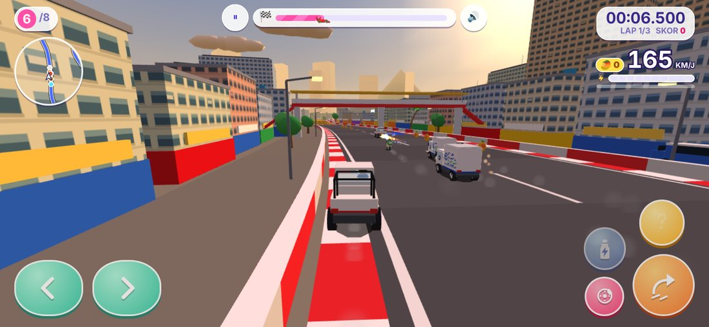
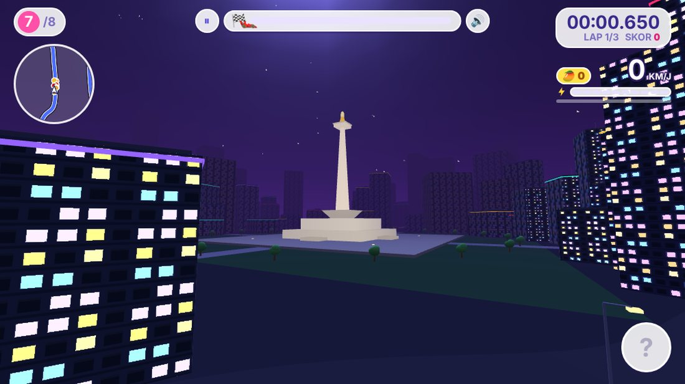
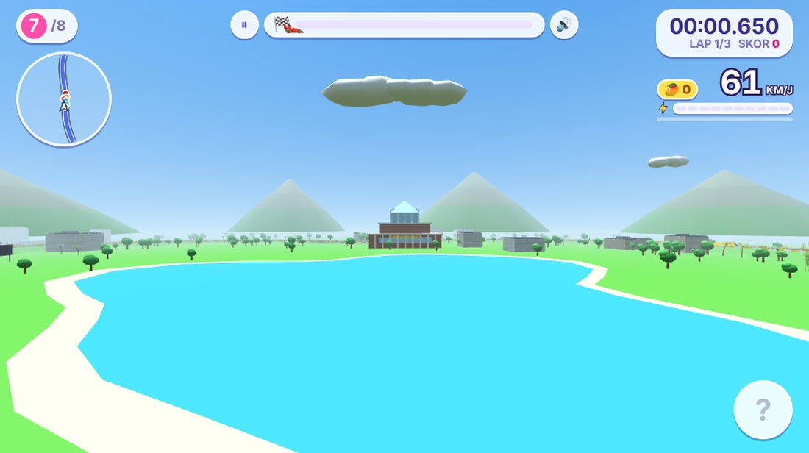
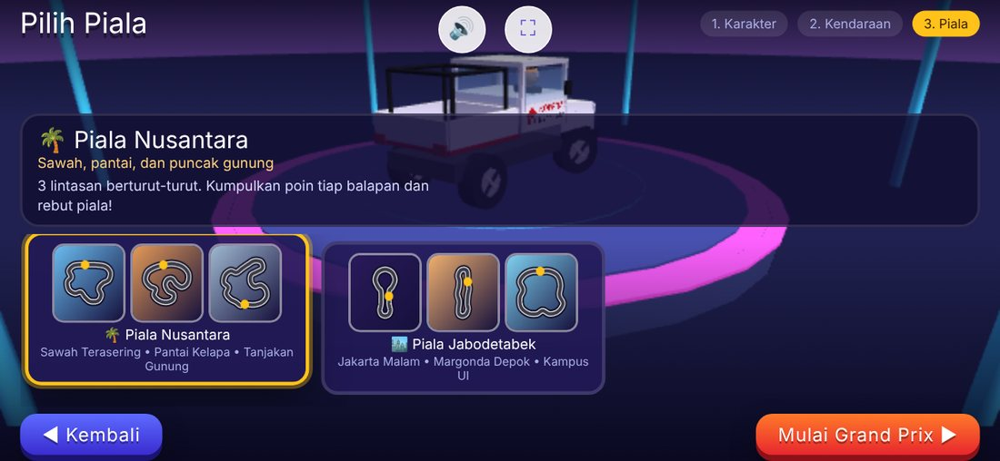
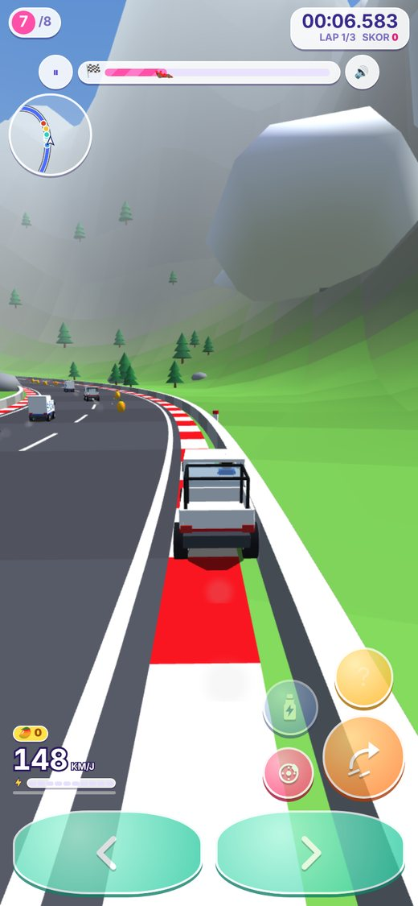
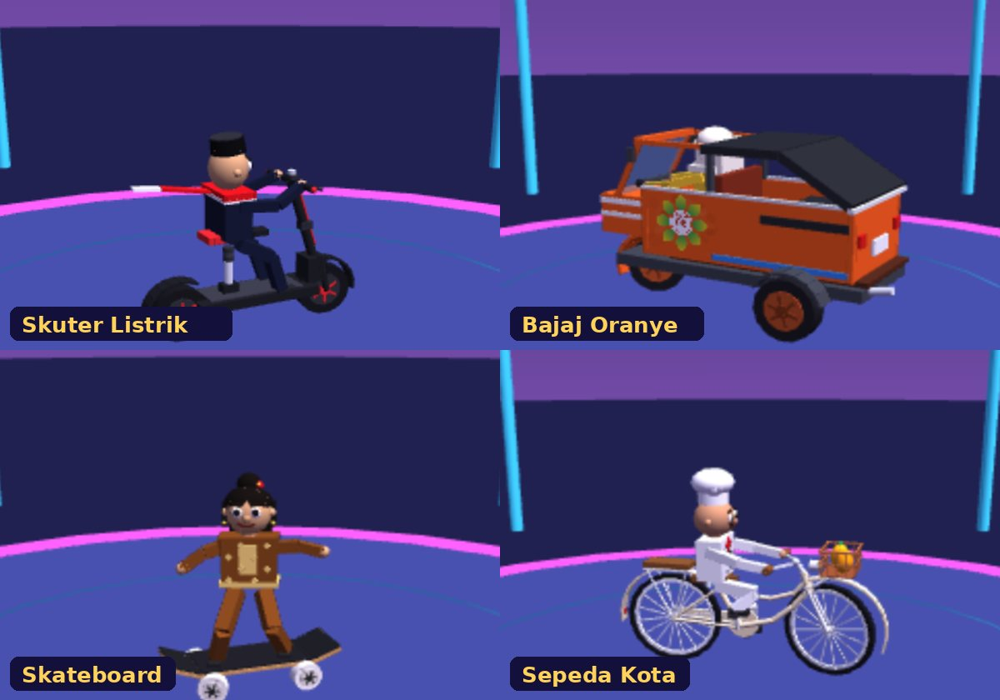

# Numind Nusantara Racing 🏁🥭

Game balap kart 3D bertema Nusantara yang berjalan langsung di browser, baik di HP maupun desktop. Dibuat oleh **Numind**.

Tanpa framework, tanpa dependensi, tanpa unduhan aset: seluruh game (model 3D, tekstur, musik, efek suara) dibangkitkan lewat kode dan WebGL, lalu dikemas dalam **satu file `index.html`**.

> English: a self-contained 3D kart racer for the browser (touch and desktop), themed on Indonesian landmarks. Single `index.html`, raw WebGL, no dependencies.

| | |
|---|---|
|  |  |
|  |  |

<p align="center"></p>

<p align="center"></p>

## Main sekarang

Setelah diunggah ke GitHub, aktifkan **GitHub Pages** (lihat bagian [Deploy](#deploy-ke-github-pages)). Game bisa juga dibuka langsung dengan mengklik dua kali `index.html`; cukup koneksi internet untuk memuat font Fredoka dari Google Fonts (tanpa internet tetap jalan dengan font cadangan).

## Fitur

- **6 lintasan** dalam 2 piala Grand Prix:
  - 🌴 **Piala Nusantara:** Sawah Terasering, Pantai Kelapa, Tanjakan Gunung (menanjak ke puncak berkabut, hutan pinus, salju)
  - 🏙️ **Piala Jabodetabek:** Jakarta Malam (Monas, Bundaran HI, JPO, ondel-ondel), Margonda Depok (ruko, angkot, Tugu Belimbing, KRL lewat), Kampus UI (danau, Perpustakaan, Balairung, bikun, KRL)
- **12 karakter** dengan keunggulan berbeda (kecepatan, akselerasi, kelincahan, tameng, drift, dan lain-lain)
- **8 kendaraan**, masing-masing punya statistik dan bonus sendiri (lihat tabel di bawah)
- **Mode:** Grand Prix, Balapan Cepat, Time Trial
- **Mangga 🥭:** tiap mangga memberi poin dan mengisi NOS 10%. NOS ditahan untuk nitro. Skor juga datang dari drift, serangan, lap, dan posisi finis.
- **Power-slide (drift)** bertingkat dengan turbo, start roket, papan turbo, dan rampa lompatan
- **Item:** Sambal (peluru pencari), Paku (ranjau), Tameng, Turbo; pembalap di belakang mendapat item lebih bagus
- 7 pembalap AI dengan rubber banding
- **Ramah HP:** kontrol sentuh berikon, mode lanskap dan potret, layar penuh, resolusi menyesuaikan performa
- HUD sederhana yang tidak menutupi jalan, dengan satu satuan ukuran yang proporsional di semua layar
- Musik dan efek suara dibangkitkan lewat Web Audio, tiap lintasan punya tema musik sendiri; suara mesin berbeda untuk motor/truk, skuter listrik, bajaj, dan kendaraan tanpa mesin

## Kendaraan

| Kendaraan | Kecepatan | Akselerasi | Kelincahan | Bobot | Bonus |
|---|:-:|:-:|:-:|:-:|---|
| 🚚 Truk Gizi | 8 | 3 | 3 | 9 | - |
| 🛻 Pickup Desa 4x4 | 6 | 5 | 5 | 6 | - |
| 🛵 Ojol Hijau | 5 | 8 | 6 | 3 | - |
| 🛵 Kurir Oranye | 4 | 6 | 9 | 2 | - |
| 🛴 Skuter Listrik | 6 | 9 | 6 | 3 | Turbo bertahan 20% lebih lama |
| 🛺 Bajaj Oranye | 5 | 4 | 6 | 7 | Tameng bertahan 30% lebih lama |
| 🛹 Skateboard | 3 | 7 | 10 | 1 | Drift terisi 35% lebih cepat |
| 🚲 Sepeda Kota | 3 | 6 | 8 | 2 | Keranjang menyedot mangga dari jarak 25% lebih jauh |

Statistik akhir adalah gabungan kendaraan dan karakter yang dipilih.

## Kontrol

| Aksi | Keyboard | Sentuh |
|---|---|---|
| Gas | `↑` / `W` | otomatis |
| Rem / mundur | `↓` / `S` | tombol cakram |
| Belok | `←` `→` / `A` `D` | panah kiri / kanan (geser jari untuk berpindah) |
| Lompat kecil + drift | `Shift` / `Spasi` | ikon tikungan (tahan) |
| Pakai item | `E` / `Ctrl` | ikon item |
| NOS (tahan) | `N` / `Q` | ikon botol |
| Kembali ke lintasan | `R` | |
| Jeda / suara | `Esc` `P` / `M` | tombol di HUD |

Gamepad juga didukung.

## Struktur proyek

```
index.html        game siap main (hasil build, satu file)
build.js          menggabungkan src/ + logo menjadi index.html
assets/logo.png   logo Numind (disematkan sebagai data URI)
src/
  m_math.js       vektor, matriks, utilitas
  m_models.js     model 3D prosedural: kendaraan, karakter, tekstur kanvas
  m_scenery.js    pemandangan: pohon, gedung, Monas, Tugu, KRL, dan lain-lain
  m_tracks.js     definisi dan generator lintasan (spline, tepi jalan, medan gunung)
  m_gl.js         renderer WebGL 1 (shader, kabut, langit, partikel)
  m_audio.js      musik dan efek suara
  m_game.js       fisika kart, item, AI, skor, aturan balapan
  m_ui.js         menu, HUD, kontrol sentuh, layar hasil
  body.html       markup HUD dan menu
  style.css       gaya
docs/screenshots/ gambar untuk README
```

## Build ulang

Perlu Node.js (tanpa paket tambahan):

```bash
node build.js        # menghasilkan index.html
npx serve .          # opsional: jalankan server lokal
```

Edit file di `src/`, jalankan `node build.js`, lalu muat ulang `index.html`.

## Deploy ke GitHub Pages

1. Buat repositori baru di GitHub, lalu unggah seluruh isi folder ini (termasuk `index.html` dan `.nojekyll`).
2. Buka **Settings → Pages**.
3. Pada **Build and deployment**, pilih **Deploy from a branch**, branch `main`, folder `/ (root)`, lalu **Save**.
4. Tunggu sekitar satu menit. Game tersedia di `https://<username>.github.io/<nama-repo>/`.

## Catatan

- Seluruh karakter, kendaraan, dan lintasan dalam game ini adalah rekaan dan hanya terinspirasi tempat dan suasana nyata. Karakter berupa kartun orisinal, bukan potret orang sungguhan.
- Game ini terinspirasi dari gaya balap kart arkade klasik, tetapi tidak memakai kode, model, musik, atau aset dari game lain.
- Logo Numind (`assets/logo.png`) milik Numind.
- Lisensi: belum ditentukan. Tambahkan berkas `LICENSE` sesuai kebutuhan sebelum repositori dibuat publik.
